# Four-CLS expression-profile encoder

This document describes the expression-profile path selected by
`configs/final_tf.yaml`. The DNA encoder and prediction Transformer keep their
existing ModernBERT attention behavior.

## Current model

```mermaid
flowchart LR
    profile["Ordered expression profile"] --> bins["50 fixed expression bins"]
    bins --> panel["BOS and four gene quarters with shared CLS"]
    panel --> localLayer["Layer 1: bidirectional local attention, plus or minus 8"]
    localLayer --> globalLayer["Layer 2: full bidirectional attention"]
    globalLayer --> readouts["Four ordered CLS states, shape B x 4 x 256"]
    readouts --> concat["Concatenate, shape B x 1024"]
    concat --> adapter["Linear, GELU, Linear adapter, width 1024"]
    adapter --> conditionNorm["Frozen conditioning LayerNorm, width 1024"]

    dnaTokens["DNA tokens"] --> dnaEncoder["Existing DNA encoder"]
    dnaEncoder --> dnaNorm["DNA LayerNorm"]
    conditionNorm --> addCondition["Broadcast and add"]
    dnaNorm --> addCondition
    addCondition --> predictionModel["Existing prediction Transformer"]
    predictionModel --> outputHead["DNA CLS expression prediction"]
```



The expression encoder has hidden width 256, MLP width 256, two layers, four
attention heads, ReLU activation, and a 57-token vocabulary. Its full
architecture is serialized in
`configs/expression_profile_encoder_4cls/config.json`. The config records
`torch_dtype` as the valid Transformers name `bfloat16`; `parameter_dtype` is
recorded separately as `float32`. Downstream training still uses BF16 mixed
precision.

The explicit serialized attention schedule is `local, global`. It is consumed
before rotary embeddings are created. Layer IDs remain 0 and 1, so layer 0
retains ModernBERT's identity pre-attention normalization. The custom classes
inherit the normal ModernBERT forward path, including FlashAttention 2.

The concatenated readout passes through a newly initialized two-layer
1,024-to-1,024 GELU projection adapter before the frozen conditioning LayerNorm.
The adapter has 2,099,200 parameters. Together with the 933,376-parameter
encoder, the trainable expression branch contains exactly 3,032,576 parameters.
The DNA encoder, prediction Transformer, both conditioning LayerNorms, and
prediction head are frozen and kept in evaluation mode; only `tf` and
`tf_adapter` remain in training mode.

## Canonical panel encoding

For `N` ordered genes, contiguous quarter sizes are computed with `divmod(N,
4)`. Remainder genes go to earlier quarters. The token sequence is:

```text
[BOS] + quarter_1 + [CLS] + quarter_2 + [CLS]
      + quarter_3 + [CLS] + quarter_4 + [CLS]
```

All four occurrences use CLS ID 0. The seven existing special-token IDs remain
0 through 6, and `[BIN_0]` through `[BIN_49]` remain IDs 7 through 56. For
24,830 genes, quarter sizes are `6208, 6208, 6207, 6207`, CLS positions are
`6209, 12418, 18626, 24834`, and total length is 24,835.

The downloaded profiles used by the current `final_tf.yaml` contain 24,759
canonical genes. Their actual geometry is `6190, 6190, 6190, 6189`, CLS
positions `6191, 12382, 18573, 24763`, and 24,764 total tokens. Raw files have
three measured-gene subsets and two column orders; they are mapped by gene ID
to the persisted canonical order, with absent values encoded as `[UNK]`.

The gene-to-token map accounts for the inserted CLS tokens. Target masking uses
that map, so only the target gene's expression token is replaced by `[MASK]`.
Unknown/dummy panels use the same four-CLS layout. All persisted panels have one
fixed length and are validated before training, so no expression padding mask is
transferred to the GPU. Validation utilities still support padded panels and
reject rows that do not have exactly four unmasked CLS tokens.

## Training hot path

The canonical panels are deduplicated into a `uint8` bank and registered as a
non-persistent model buffer. The complete existing-profile bank occupies about
20 MiB and moves to the GPU once with the model. Dataset samples transfer only
`int32` panel indices and target token positions; the selected gene is replaced
by `[MASK]` after the GPU gather. The bank is reconstructed from the canonical
data bundle when a job starts and is deliberately absent from model checkpoints.

Training DataLoader batches now equal the physical batch size. Ten physical
batches are consumed sequentially for the configured effective batch of 80, so
the previous 80-item tensor batch is never transferred to or resident on the
GPU. Full predictions are retained only for validation/test metrics. The model
also uses fixed-position CLS gathering without CUDA scalar checks, computes MSE
and the prediction head only at DNA position zero, and applies the frozen DNA
LayerNorm before expanding repeated promoter representations.

## Encoding and checkpoint contract

Every expression checkpoint must carry these files:

- `config.json` with `expression_attention_schedule: [local, global]`;
- `panel_genes.txt`, one canonical gene ID per line in sequence order;
- `bin_edges.npy`, the 49 fixed edges for the 50 expression bins;
- `expression_encoding.json`, containing hashes, token IDs, CLS placement, and
  attention schedule;
- tokenizer files preserving the exact 57-token vocabulary;
- model weights produced by `ExpressionModernBertModel.save_pretrained`.

Create the non-weight artifacts from the expression-pretraining pipeline with:

```python
from downstream_tasks.expression_prediction.expression_profile_encoder import (
    ExpressionModernBertModel,
    save_encoding_bundle,
)

model.save_pretrained(checkpoint_dir)
save_encoding_bundle(checkpoint_dir, ordered_genes, bin_edges, tokenizer)
```

Expression pretraining must import `ExpressionModernBertModel`, construct panels
with `build_four_cls_panel`, use the canonical gene list and bin edges for every
split, and mask genes through `gene_token_positions`. No expression-pretraining
entry point exists in this repository, so those changes must be made in the
external pretraining project.

The downloaded archive did not contain trustworthy historical metadata for the
old expression checkpoint. A new bundle was therefore generated for the new
scratch-initialized encoder from the existing 24,759-gene panel, its 49 bin
edges, and the preserved tokenizer. `profile_provenance.json` records all 858
input profiles, three raw schema hashes, source hashes, and the missing
historical-metadata fact. Missing new-bundle metadata remains a hard error.
Train and validation use one canonical order and encoding signature.

The old 1,024-wide expression backbone is incompatible with the new 256-wide
backbone. `final_tf.yaml` therefore initializes the expression encoder from
scratch (`tf_model_path: null`) while its legacy downstream initialization
checkpoint can still provide compatible DNA encoder, prediction Transformer,
conditioning LayerNorm, and prediction-head weights. Legacy expression keys
under `tf.*` are discarded with an explicit warning. Set `tf_model_path` only
to a matching four-CLS expression checkpoint.

The historical `all_datasets_2` checkpoint calls the compatible conditioning
LayerNorm `desc_ln`; loading remaps it to `tf_ln`. Missing adapter tensors are
reported as intentional scratch initialization. Any genuinely missing frozen
predictor tensor is a hard error. Full downstream checkpoints contain both
`tf.*` and `tf_adapter.*`, and the optimizer is built only from those trainable
parameters.

`final_tf.yaml` now uses the downloaded archive's train/validation mappings,
GRCh38 FASTA, DNA/prediction checkpoints, and generated four-CLS tokenizer
bundle. The archive has no independent test mapping. Rebuild the bundle with
`prepare_existing_expression_profiles.py`; it validates duplicates and genes
outside the canonical panel before writing metadata.

## Validation

Focused CPU tests are in `tests/`. They cover
quartering and exact CLS positions, non-divisible gene counts, target masking,
unknown panels and padding, ordered gathering and output shape, local-to-global
attention, layer index/normalization preservation, save/reload, legacy
incompatibility, encoding-order rejection, all-readout gradients, and a small
forward/backward pass.

Run them with:

```bash
python -m pytest -q \
  downstream_tasks/expression_prediction/tests
```

The optimization tests additionally cover panel-bank deduplication, GPU-side
target masking, non-persistent bank serialization, physical-batch grouping, and
the absence of training-time prediction retention. Result in this environment:
`22 passed`.

## GPU memory measurement

The reproducible benchmark is
`benchmarks/benchmark_expression_encoder.py`. Both models ran in isolated
processes on an NVIDIA H100 80GB HBM3 with batch size 1, 24,830 genes, FP32
parameters and AdamW states, BF16 autocast, FlashAttention 2, and gradient
checkpointing disabled. One update initialized optimizer states, two additional
updates warmed kernels and caches, then five updates were measured. Peak values
below are CUDA allocator measurements, not calculated tensor-size estimates.

| Encoder | Tokens | Parameters | Peak allocated | Peak reserved | Median step |
|---|---:|---:|---:|---:|---:|
| Legacy, width 1,024 | 24,832 | 14,743,552 | 2,154.45 MiB | 2,472 MiB | 67.50 ms |
| Four-CLS plus adapter | 24,835 | 3,032,576 | 584.61 MiB | 724 MiB | 17.66 ms |

The redesigned trainable branch reduced parameters by 79.43%, measured peak
allocated memory by 72.87%, peak reserved memory by 70.71%, and median step time by 73.83%
under this benchmark. End-to-end downstream training will also include the DNA
encoder, prediction Transformer, and dataset batch multiplicity, so its total
memory is larger than these expression-branch-only measurements.
