# Expression Perturbation Model Architecture

This document describes the model currently configured by
[`configs/final_pert.yaml`](configs/final_pert.yaml) and implemented in
[`expression_model_final_pert.py`](expression_model_final_pert.py).

## Model flow

```mermaid
flowchart LR
    dnaInput[/"DNA tokens [B, 16, 1024]"/]
    dedup[Deduplicate repeated sequences]
    dnaEncoder["ModernGENA DNA encoder: 28 layers"]
    dnaNorm[DNA LayerNorm]

    panelInput[/"Expression panel tokens [B, 16, T]"/]
    panelEncoder["TF panel ModernBERT: 2 layers"]
    panelCls[Last real token state]
    panelNorm[TF LayerNorm]
    broadcast[Broadcast over DNA tokens]

    fusion((Add))
    decoder["ModernBERT decoder: 3 layers"]
    head["Linear head: 1024 to 1"]
    predictions[/"Expression predictions [B x 16, 1024, 1]"/]
    loss["Masked MSE: CLS plus 8 x non-CLS"]

    dnaInput --> dedup --> dnaEncoder --> dnaNorm --> fusion
    panelInput --> panelEncoder --> panelCls --> panelNorm --> broadcast --> fusion
    fusion --> decoder --> head --> predictions --> loss

    style dnaEncoder fill:#C2E5FF,stroke:#3DADFF
    style panelEncoder fill:#DCCCFF,stroke:#874FFF
    style fusion fill:#FFECBD,stroke:#FFC943
    style decoder fill:#C6FAF6,stroke:#5AD8CC
    style predictions fill:#CDF4D3,stroke:#66D575
```



`B` is the batch size, `N = 16` is the number of perturbation tracks in a
sample group, `L = 1024` is the DNA sequence length, `T <= 24,832` is the
expression-panel sequence length, and the hidden width is `H = 1024`.

## Components

### DNA encoder

- Local model: `models/modernbert_large`
- Architecture: ModernBERT/ModernGENA
- 28 layers, 16 attention heads, hidden width 1,024
- Vocabulary size 32,768 and maximum sequence length 1,024
- Embeddings and the first 26 layers are frozen
- The last two layers and final normalization are trainable
- Repeated DNA inputs are encoded once and expanded back to their original
  track positions

### Expression-panel encoder

- Local model: `models/moderngena-tf-bins50`
- Two ModernBERT layers, eight attention heads, hidden width 1,024
- Vocabulary size 57 and maximum sequence length 24,832
- Encodes binned expression values for the fixed panel of 24,759 genes
- The hidden state of the last real token is used as the panel representation
- The complete component is trainable

### Fusion and decoder

The DNA sequence and panel representation are normalized independently. The
panel vector is broadcast over valid DNA-token positions and added to the DNA
hidden states. The fused representation is processed by a three-layer
ModernBERT decoder with eight attention heads and hidden width 1,024.

The decoder's token embeddings are frozen because the decoder receives
`inputs_embeds` rather than token IDs. A trainable linear layer maps each
decoder token from 1,024 hidden features to one expression value.

## Objective

The configured activation is the identity function. Training uses masked,
unreduced mean squared error:

```text
loss = CLS MSE + 8 * non-CLS MSE
```

Deviation-from-mean and multinomial auxiliary losses are implemented but are
disabled by the current configuration.

## Parameters

| Component | Total parameters | Trainable parameters |
|---|---:|---:|
| DNA encoder | 376,759,296 | 24,515,584 |
| Expression-panel encoder | 14,743,552 | 14,743,552 |
| Decoder | 55,581,696 | 22,027,264 |
| DNA LayerNorm | 2,048 | 2,048 |
| TF LayerNorm | 2,048 | 2,048 |
| Output head | 1,025 | 1,025 |
| **Total** | **447,089,665** | **61,291,521** |

## Runtime

The launcher uses bf16 mixed precision and Flash Attention 2. The initial
checkpoint is loaded from `models/all_datasets_2/pytorch_model.bin` with
non-strict state-dictionary loading so that the pretrained TF-panel encoder can
remain initialized from its own model directory.
